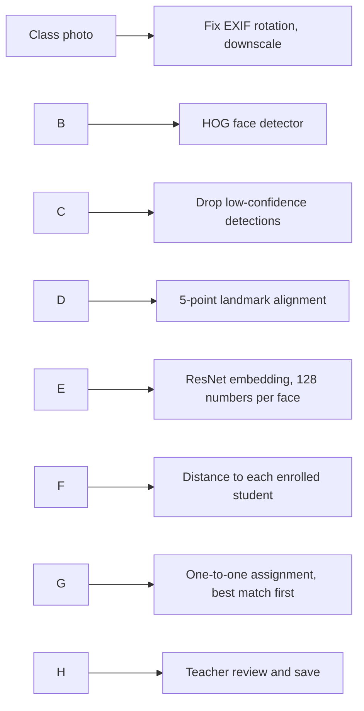

# SNAP CLASS: AI Attendance System

[!\[CI](https://github.com/Rati-Akela/AI-Attendance-System/actions/workflows/ci.yml/badge.svg)](https://github.com/Rati-Akela/AI-Attendance-System/actions/workflows/ci.yml)
!\[Python](https://img.shields.io/badge/python-3.11%20|%203.12%20|%203.13-blue)
!\[License](https://img.shields.io/badge/license-MIT-green)

Take attendance with **one photo**. A teacher uploads a picture of the classroom; SNAP CLASS detects every face, matches each one against the students enrolled in that subject, and marks them present. The teacher reviews the result, fixes any mistakes, and saves. Reports, low-attendance alerts, and a student portal come built in.

**\*\*Live demo:\*\* \[ai-attendance-system.streamlit.app](https://ai-attendance-system-blrtauc8zshzju9qzkdr2t.streamlit.app) (click "Open the teacher demo" on the login page, no sign-up needed)**

|Take attendance|Dashboard|
|-|-|
|!\[Take attendance](docs/screenshots/take-attendance.png)|!\[Dashboard](docs/screenshots/dashboard.png)|
|**Reports**|**Sign in**|
|!\[Reports](docs/screenshots/reports.png)|!\[Login](docs/screenshots/login.png)|

## Features

* **Group-photo attendance.** Upload one or several class photos (or use the camera). Recognised faces get green name labels; unmatched faces get red "Unknown" boxes.
* **Teacher stays in control.** Every result goes through a review table where each student's presence can be corrected before saving. Each record notes whether it came from `face` or `manual` marking.
* **Student enrolment.** Enrol students with one or more face photos. Photos with no face, or with several faces, are rejected with a clear message.
* **Subjects and rosters.** Each subject has its own roster, so only the students who belong to that class can be matched.
* **Reports.** Per-student attendance %, trend over time, a class-by-class register, subject comparison, and CSV export. Students below a configurable threshold (default 75%) are flagged.
* **Student portal.** Students sign in with a generated ID and access code to see their own attendance by subject.
* **Authentication.** PBKDF2-SHA256 salted password hashing (200k iterations), per-teacher data isolation, hashed student access codes.
* **Demo mode.** One environment variable loads a populated demo classroom so a fresh deployment is never empty.

## How face recognition works



1. **Detection:** dlib's HOG + linear SVM detector finds faces. Detections with a low confidence score are discarded; the HOG detector occasionally fires on flags or posters, and the tests include a real photo where this happens.
2. **Embedding:** each face is aligned and passed through dlib's ResNet model, giving a 128-dimensional vector.
3. **Matching:** a student's distance to a face is the smallest distance across their enrolled photos. A face matches a student if the distance is under the threshold (default `0.5`, stricter than dlib's usual `0.6` because a wrong "present" is worse than one the teacher has to tick).
4. **One-to-one assignment:** candidate pairs are assigned greedily, best first, so a student can never be marked by two faces and two look-alikes can't claim the same face.

### Privacy

Only the 128-number embedding is stored, **never the photo**. Class photos are processed in memory and discarded. If you deploy this for real students you need their consent and should check your local data-protection rules.

### Known limitations

* **No liveness detection:** a printed photo held up to the camera would be recognised. The teacher-review step is the mitigation today.
* Accuracy drops for faces smaller than roughly 80 px, strong side-on angles, masks, and poor lighting. Use several photos for large rooms, or raise `SNAP\_UPSAMPLE`.
* Face recognition accuracy varies across demographics; treat the output as a time-saving suggestion that a human confirms, not as ground truth.

## Tech stack

|Layer|Technology|
|-|-|
|UI|Streamlit (multipage via `st.navigation`)|
|Face AI|dlib (HOG detector, ResNet face embeddings), NumPy|
|Data|SQLite, pandas|
|Imaging|Pillow|
|Quality|pytest (51 tests, including real-model tests and headless UI tests), ruff, GitHub Actions|
|Deploy|Streamlit Community Cloud or Docker|

## Project structure

```
app.py                  Streamlit entry point and navigation
snapclass/
  config.py             Settings from environment variables
  auth.py               Password hashing, validation, credential generation
  db.py                 SQLite schema and queries
  faces.py              Detection, embedding, matching, annotation
  reports.py            pandas analytics
  demo.py               Demo-data seeding
  theme.py              Styling
  views/                One module per page
tests/                  Unit, integration and UI tests
.github/workflows/      CI (lint, tests on Python 3.11-3.13, Docker build)
```

## Run locally

```bash
git clone https://github.com/Rati-Akela/AI-Attendance-System.git
cd AI-Attendance-System
python -m venv .venv \&\& source .venv/bin/activate   # Windows: .venv\\Scripts\\activate
pip install -r requirements.txt
SNAP\_DEMO\_MODE=1 streamlit run app.py               # Windows PowerShell: $env:SNAP\_DEMO\_MODE=1; streamlit run app.py
```

Open http://localhost:8501. Create a teacher account (or use the demo button), add a subject, enrol a student with a clear photo, then try **Take attendance**.

Run the checks:

```bash
pip install -r requirements-dev.txt
make lint test      # or: ruff check . \&\& pytest
```

## Deploy

### Option A: Streamlit Community Cloud (free, \~3 minutes)

1. Push this repo to GitHub.
2. Go to [share.streamlit.io](https://share.streamlit.io), choose **Create app**, select this repo, and set the main file to `app.py`.
3. Under **Advanced settings**, pick Python 3.12 (or 3.13) and paste into **Secrets**:

```toml
   SNAP\_DEMO\_MODE = "1"
   SNAP\_TIMEZONE = "Asia/Kolkata"
   ```

4. Deploy, then put the URL at the top of this README.

> Streamlit Community Cloud storage is \*\*ephemeral\*\*: the SQLite file is reset when the app restarts. That's fine for a portfolio demo (demo mode re-seeds itself), but not for real use. For persistence use Option B or point `SNAP\_DB\_PATH` at a mounted volume.

### Option B: Docker (persistent)

```bash
docker compose up --build        # http://localhost:8501, data kept in a named volume
```

The same image runs on Render, Fly.io, Railway or any VPS; mount a volume at `/data`.

## Configuration

All optional, set as environment variables (Streamlit secrets also work).

|Variable|Default|Meaning|
|-|-|-|
|`SNAP\_DB\_PATH`|`data/snapclass.db`|SQLite file location|
|`SNAP\_MATCH\_THRESHOLD`|`0.5`|Max face distance for a match (lower = stricter)|
|`SNAP\_MIN\_FACE\_SCORE`|`0.25`|Minimum detector confidence to keep a face|
|`SNAP\_UPSAMPLE`|`1`|Detector upsampling; use `2` for big rooms / small faces (slower)|
|`SNAP\_MAX\_IMAGE\_SIDE`|`1800`|Photos are downscaled to this on the long side|
|`SNAP\_LOW\_ATTENDANCE`|`75`|"At risk" threshold, in percent|
|`SNAP\_TIMEZONE`|`Asia/Kolkata`|Timezone for displayed dates|
|`SNAP\_DEMO\_MODE`|`0`|`1` shows the demo button on the login page|

## Roadmap

* Voice-based identification (the original idea; not implemented yet)
* Liveness / anti-spoofing check
* Live camera stream instead of still photos
* Email alerts for low attendance
* Postgres support for multi-instance deployments

## Author

**Rati Kumari Akela**, Computer Science student interested in AI, machine learning and software development.

Licensed under the [MIT License](LICENSE).

